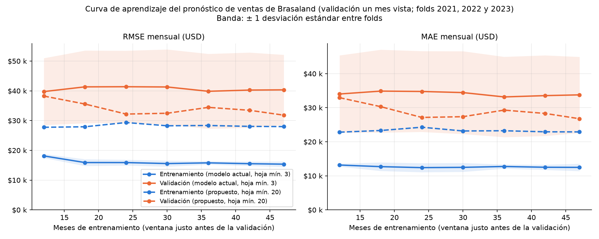

# Evaluación técnica del pronóstico de ventas de Brasaland

**Modelo evaluado:** el Random Forest del pronóstico mensual de `revenue_usd`, fila `consolidated` de `data/raw/brasaland_sales.csv` (`data/process/sales_forecast.py`). Parámetros: `n_estimators=500`, `min_samples_leaf=3`, `max_features=0.6`, `random_state=42`. Predice la razón interanual `revenue_t / revenue_(t-12)` con lags de 1, 2, 3 y 12 meses, medias y desviación móviles y señales de calendario (mes cíclico, enero y diciembre).

**Datos:** solo los 8 años de entrenamiento (2016-01 a 2023-12). Los 2 años de prueba (2024-2025) no se tocan en esta evaluación: siguen reservados como prueba final, para no elegir la corrección mirando la prueba.

**Reproducir:**

```bash
uv run python scripts/evaluate_sales_forecast.py
uv run --group test python -m pytest tests/pipelines/test_model_evaluation.py
```

Gráficas: `data/eval/learning_curve.png` y `data/eval/regularization_curve.png`. Detalle por fold: `data/eval/evaluation_metrics.json`, que se genera al ejecutar el script.

---

## Diagnóstico: **overfitting moderado**

El modelo memoriza el ruido mensual del entrenamiento. Lo muestran tres pruebas:

1. **El error de entrenamiento está por debajo del ruido irreducible.** Según el BRIEFING, los meses normales fluctúan ±5 % alrededor de la tendencia. Ese ruido ya supone un error medio de ~2,5 % (≈ 15 k USD) que ningún modelo puede predecir. El modelo marca un **1,8 %** en entrenamiento (RMSE 13,5 k USD), así que está ajustando ruido.
2. **La brecha es amplia y no se cierra.** En validación cruzada, el RMSE de validación (37,3 k USD) es **2,8 veces** el de entrenamiento.
3. **Más datos no la reducen.** En la curva de aprendizaje, las dos líneas son planas, cada una a su altura. Pasar de 12 a 47 meses de entrenamiento no mejora la validación (≈ 40 k USD de RMSE).

No es **underfitting**: el error de entrenamiento no es alto. Tampoco está **bien ajustado**, porque las curvas no convergen.

Hay una prueba de causalidad. Si se regulariza solo el tamaño mínimo de hoja, el error de entrenamiento sube y el de validación baja, ambos de forma monótona (`regularization_curve.png`). Es el comportamiento de un modelo con exceso de varianza.

---

## 1. Validación cruzada temporal

**Estrategia:** `TimeSeriesSplit(n_splits=5, test_size=12)` sobre las 83 muestras de entrenamiento. Se pierden 13 meses de 2016, que son la historia mínima para los lags. Es una ventana expansiva: cada fold entrena con todo lo anterior a su ventana de validación, de 12 meses, un ciclo estacional completo.

| Fold | Entrena con | Valida con | Muestras de entrenamiento |
|---|---|---|---:|
| 1 | 2017-02 a 2018-12 | 2019 | 23 |
| 2 | 2017-02 a 2019-12 | 2020 | 35 |
| 3 | 2017-02 a 2020-12 | 2021 | 47 |
| 4 | 2017-02 a 2021-12 | 2022 | 59 |
| 5 | 2017-02 a 2022-12 | 2023 | 71 |

**Sin barajar y sin fuga entre folds:**

- **Orden de los folds.** Ningún fold baraja los datos: los índices son contiguos y crecientes, todo el entrenamiento es anterior a la validación y ningún índice de un fold posterior aparece antes que uno anterior. Lo comprueba `test_folds_preserve_the_chronological_order`.
- **Features por fold.** Las features se **reconstruyen dentro de cada fold** a partir de la serie cortada en el último mes de ese fold (`model_evaluation.fold_features`). Un lag o una media móvil no puede ver un mes posterior al fold. Las filas de entrenamiento de un fold tampoco ven sus meses de validación, porque todas las features miran solo hacia atrás. Los tests multiplican por 10 los meses posteriores al fold, o los de validación, y comprueban que las features y las métricas del fold no cambian.
- **Escalador.** El `StandardScaler` está dentro del pipeline, así que se ajusta en cada fold solo con sus filas de entrenamiento.
- **Tipo de validación.** Se valida **a un mes vista**: cada mes se predice con los meses reales anteriores, la configuración estándar para diagnosticar sesgo y varianza. También se informa del pronóstico **recursivo** de 12 meses, que es como se usa en la entrega.

### Resultados (media ± desviación estándar entre los 5 folds)

| | MAE (USD) | RMSE (USD) | MAPE |
|---|---:|---:|---:|
| Entrenamiento | 10.685 ± 1.550 | 13.521 ± 1.737 | 1,84 % ± 0,21 |
| **Validación (a un mes vista)** | **31.279 ± 9.085** | **37.324 ± 9.787** | **4,79 % ± 1,04** |
| Validación (recursiva, 12 meses) | 31.933 ± 7.809 | 38.435 ± 8.075 | 4,90 % ± 0,91 |
| Referencia: línea base estacional (mismo mes del año anterior × crecimiento medio) | 26.826 ± 4.506 | 31.992 ± 4.351 | 4,13 % ± 0,50 |

**Estabilidad:** depende de qué años se usen para entrenar.

| Año validado | RMSE validación (USD) | MAPE | Sesgo |
|---|---:|---:|---:|
| 2019 | 34.843 | 4,94 % | −3,4 % |
| 2020 | 34.042 | 4,83 % | +3,1 % |
| 2021 | 33.461 | 4,19 % | −2,9 % |
| 2022 | 29.788 | 3,62 % | +1,4 % |
| 2023 | **54.485** | **6,39 %** | **−6,2 %** |

- **Variación entre folds.** La desviación del RMSE de validación (±9,8 k USD, un 26 % de la media) es **5,6 veces** la de entrenamiento (±1,7 k). El desempeño varía mucho según la ventana de entrenamiento, otro síntoma de varianza.
- **El año 2023.** Concentra el peor error. Fue el año atípico de +9 % (fuera del 3-7 % del BRIEFING) y el modelo lo **subestimó** un 6 %. Es el mismo problema que, al entrar como lag, lo hizo **sobreestimar** 2024-2025 (+6,4 % en la prueba final). El modelo sigue demasiado de cerca los últimos meses.
- **El sesgo cambia de signo entre folds** (−3,4 % a +3,1 %). No hay un sesgo sistemático que corregir con un ajuste fijo.

---

## 2. Curva de aprendizaje



**Cómo se construye:**

- **Tamaños.** Para cada tamaño (12, 18, 24, 30, 36, 42 y 47 meses), el modelo se entrena con los *n* meses **inmediatamente anteriores** a la ventana de validación.
- **Folds.** Todos los tamaños se evalúan sobre las **mismas** ventanas: 2021, 2022 y 2023, los 3 folds que tienen al menos 47 meses de entrenamiento. Así la curva solo refleja la cantidad de datos.
- **Banda.** La banda es ±1 desviación entre folds.

| Meses de entrenamiento | 12 | 18 | 24 | 30 | 36 | 42 | 47 |
|---|---:|---:|---:|---:|---:|---:|---:|
| RMSE de entrenamiento, modelo actual (k USD) | 18,1 | 15,9 | 15,9 | 15,6 | 15,8 | 15,5 | 15,4 |
| RMSE de validación, modelo actual (k USD) | 39,7 | 41,3 | 41,4 | 41,3 | 39,8 | 40,2 | 40,3 |
| RMSE de entrenamiento, propuesto `min_samples_leaf=20` (k USD) | 27,7 | 27,9 | 29,3 | 28,3 | 28,4 | 28,0 | 28,0 |
| RMSE de validación, propuesto `min_samples_leaf=20` (k USD) | 38,2 | 35,6 | 32,2 | 32,5 | 34,4 | 33,5 | 31,8 |

**Interpretación del patrón:**

- **Modelo actual.** Hay una **brecha amplia y persistente**. El entrenamiento es bajo (~15 k) y la validación, alta (~40 k), y ninguna línea se mueve con más datos. Es el patrón de **overfitting**: el modelo tiene capacidad de sobra para memorizar cualquier cantidad de meses. Por eso añadir datos no corregiría el problema, y aumentar la complejidad lo empeoraría.
- **Modelo regularizado (líneas discontinuas).** La brecha se reduce de ~25 k a ~4 k USD. La validación **sí baja** al añadir meses (38,2 → 31,8 k), es decir, aprende de los datos en lugar de memorizarlos. Las dos líneas convergen hacia un error cercano al ruido irreducible del BRIEFING. Es el patrón de un modelo razonablemente ajustado.

El MAE muestra el mismo patrón en el panel derecho de la gráfica.

---

## 3. Métricas: MAE frente a RMSE

| Conjunto | MAE (USD) | RMSE (USD) | RMSE / MAE |
|---|---:|---:|---:|
| Entrenamiento (validación cruzada) | 10.685 | 13.521 | 1,27 |
| Validación (validación cruzada) | 31.279 | 37.324 | 1,19 |
| Prueba final 2024-2025 (recursiva, entrega anterior) | 51.896 | 63.104 | 1,22 |

**Métrica principal: RMSE.** El BRIEFING y el negocio de Brasaland lo justifican por cuatro razones:

1. **El coste del error crece más que en proporción a su tamaño.**
   - Felipe (Operaciones) compra insumos perecederos según la venta proyectada, y Lucía (Procurement) negocia la carne según ese volumen.
   - Un error pequeño (~2-3 %) lo absorbe el stock de seguridad.
   - Un error grande no. Si se sobreestima, la carne comprada de más se convierte en merma. Si se subestima, faltan insumos en el mes de más venta y hay que hacer compras urgentes al precio del momento.
   - El RMSE eleva cada error al cuadrado, así que pesa justo esos meses grandes. El MAE trata igual 10 meses con 10 k de error que 1 mes con 100 k.
2. **Los meses críticos son los extremos.** El BRIEFING destaca diciembre (+20-30 %) y enero (−12-18 %), y Mariana necesita anticipar los meses flojos. En esos meses el valor absoluto es mayor y un fallo cuesta más; el RMSE no los diluye entre los meses tranquilos.
3. **Es el mismo criterio que pide el BRIEFING.** El BRIEFING pide el **MSE** en USD², y el RMSE es su raíz, en USD. Se reporta en dólares y Finanzas lo puede leer.
4. **Ninguna dirección del error es claramente más barata.** El BRIEFING no dice si cuesta más sobreestimar o subestimar: la merma y la falta de stock cuestan las dos. El sesgo cambia de signo entre folds, así que una métrica simétrica es apropiada, y el sesgo se informa aparte para vigilarlo.

**El MAE se mantiene como métrica complementaria.** Responde a "¿cuántos dólares nos equivocamos en un mes típico?" (~31 k USD, el 4,8 % de la venta). Además, la razón RMSE/MAE de ~1,2 indica que los errores no dependen de un solo mes extremo, salvo el fold de 2023.

---

## 4. Acción correctiva: regularizar el tamaño mínimo de hoja, de `min_samples_leaf=3` a `20`

**Causa raíz:**

- **Pocos datos para el tamaño de hoja actual.** Con 83 muestras de entrenamiento, cada árbol puede terminar en hojas de solo 3 meses.
- **Una hoja así describe ruido.** Su predicción es la razón interanual de 3 meses concretos: su ruido de ±5 %, no un patrón.
- **Los árboles crecen hasta ese límite.** Pueden aislar los meses atípicos, como 2023, y repetir su comportamiento en el pronóstico.

Por eso el error de entrenamiento cae por debajo del ruido irreducible.

**Corrección:** exigir **al menos 20 meses por hoja** obliga a cada predicción a promediar casi dos años de razones interanuales. El ruido de un mes concreto se diluye, y la forma estacional y el crecimiento medio, que se repiten, se conservan.

**Evidencia** (validación cruzada temporal 2016-2023, sin tocar 2024-2025; `regularization_curve.png`):

| `min_samples_leaf` | RMSE de entrenamiento (USD) | RMSE de validación (USD) | MAPE de validación | Validación / entrenamiento |
|---:|---:|---:|---:|---:|
| 3 (actual) | 13.521 | 37.324 ± 9.787 | 4,79 % ± 1,04 | 2,76 |
| 6 | 18.399 | 36.007 ± 8.318 | 4,61 % ± 0,89 | 1,96 |
| 10 | 22.680 | 34.516 ± 7.675 | 4,43 % ± 0,80 | 1,52 |
| 15 | 24.513 | 33.329 ± 6.458 | 4,29 % ± 0,69 | 1,36 |
| **20 (propuesto)** | **25.176** | **32.802 ± 5.842** | **4,23 % ± 0,66** | **1,30** |
| 25 | 25.467 | 32.099 ± 4.415 | 4,15 % ± 0,51 | 1,26 |
| 30 | 25.478 | 32.071 ± 4.364 | 4,14 % ± 0,51 | 1,26 |

**Efecto de pasar de 3 a 20:**

- El RMSE de validación baja un **12 %** (de 37,3 k a 32,8 k USD).
- La inestabilidad entre folds baja un **40 %** (la desviación pasa de ±9,8 k a ±5,8 k).
- La brecha con el entrenamiento pasa de 2,8 a 1,3 veces.
- El MAPE recursivo a 12 meses también mejora, de 4,90 % a 4,26 %.

**Por qué 20 y no más:**

- A partir de 20 la mejora es menor que la variación entre folds (32,8 k frente a 32,1 k, con ±5,8 k).
- Valores mayores solo acercan el bosque a la regla "crecimiento medio constante": con tan pocas filas por fold, sus árboles casi no pueden dividirse, y el error converge al de la línea base estacional. A partir de ahí el bosque ya no aporta nada propio.
- 20 es el valor más regularizado que todavía deja varias divisiones por árbol en el ajuste final con 83 meses.

**Qué no hacer:**

- **No añadir datos como primera respuesta.** La curva de validación del modelo actual es plana: con más meses seguiría memorizando.
- **No aumentar la complejidad**, como más profundidad, XGBoost o más features. Esa es la dirección del problema. También se comprobó que quitar las features de impulso, sin regularizar, no mejora la validación (4,98 % frente a 4,79 %): el problema es el tamaño de hoja, no un feature concreto.

**Condición antes de staging:**

- **Resultado actual.** Regularizado, el modelo **iguala, pero todavía no supera**, a la línea base estacional (RMSE 32,8 k frente a 32,0 k USD, dentro de la desviación entre folds).
- **Lectura.** Con 8 años de datos, la mayor parte de la señal predecible es la estacionalidad y el crecimiento medio.
- **Recomendación para el tech lead:**
  1. Aplicar `min_samples_leaf=20` (un cambio de una línea en `sales_forecast.build_model`).
  2. Reentrenar.
  3. Aprobar el paso a staging solo si, con validación cruzada temporal, el RMSE de validación queda por debajo del de la línea base estacional.
- **Si no lo consigue,** el dashboard debería publicar la línea base estacional con el rango del modelo hasta tener una señal adicional que justifique el bosque, por ejemplo el número de ubicaciones abiertas por mes.

---

## Respuesta a las tres preguntas del ticket

1. **¿Underfitting, overfitting o bien ajustado?**
   **Overfitting moderado:**
   - el error de entrenamiento (1,8 %) está por debajo del ruido irreducible;
   - la validación es 2,8 veces el entrenamiento;
   - la curva de aprendizaje muestra una brecha amplia que no se cierra con más datos.
2. **¿Qué tan estable es?**
   **Poco estable con la configuración actual:**
   - RMSE de validación de 37,3 k ± 9,8 k USD entre folds (±26 %);
   - el peor año es el atípico 2023 (54,5 k);
   - el sesgo cambia de signo según el año.

   Regularizado, la desviación baja a ±5,8 k.
3. **¿Qué acción correctiva?**
   **Subir `min_samples_leaf` de 3 a 20:**
   - reduce el RMSE de validación un 12 % y la inestabilidad un 40 %;
   - el valor se eligió con validación cruzada temporal sobre 2016-2023, sin mirar la prueba.

   La aprobación queda condicionada a que el modelo supere a la línea base estacional.
