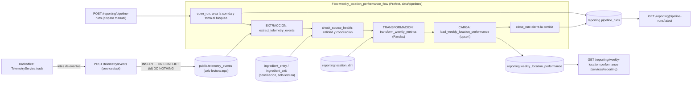

# Diseño del pipeline de desempeño de negocio — Brasaland (Parte 1 de 3)

**Estado:** diseño (sin código de orquestación todavía). **Implementación:** Parte 2. **Subflows y pruebas:** Parte 3.

Este documento diseña un pipeline **nuevo** que convierte la telemetría que ya capturamos en datos de negocio para el liderazgo de Brasaland. El reporte técnico (`services/telemetry/analysis.py`, `GET /telemetry/report`) **no se toca**, y `telemetry_events` es solo **fuente de lectura**: este pipeline nunca escribe ahí.

---

## 1. Estado actual (Fase 1)

### 1.1 Qué tenemos hoy

| Pieza | Dónde vive | Qué hace |
|---|---|---|
| Catálogo de telemetría | `docs/telemetry/telemetry-plan.md`, `docs/telemetry/event-schemas.json` | 21 eventos diseñados; las 6 métricas obligatorias del BRIEFING y 15 identificadas |
| Captura en el frontend | `uis/backoffice/services/telemetry.ts` (`track()`) | 19 de los 21 eventos instrumentados (los 6 obligatorios incluidos). Cola local, lotes de 20 eventos o 10 s, `sendBeacon` al cerrar, 3 reintentos |
| Receptor | `POST /telemetry/events` (`services/api/routes/telemetry.py`) | Valida cada evento por separado y guarda los válidos con un único bulk insert. `id` = `eventId`, con `ON CONFLICT (id) DO NOTHING` |
| Almacén | `public.telemetry_events` (Supabase) | 8 columnas: `id`, `timestamp`, `service`, `event_type`, `level`, `value`, `message`, `tags` (jsonb). `tags` = `properties` + `session_id`, `user_id`, `request_id`, `schema_version` |
| Tablas de dominio | `ingredient`, `ingredient_entry`, `ingredient_exit` (Supabase) | Entradas (con `unit_cost` opcional) y salidas (`consumption` o `waste`) de inventario, por `location_id` 1–14 |
| Reporte técnico | `services/telemetry/analysis.py`, `GET /telemetry/report`, página `/telemetry` | Cinco métricas operacionales de los últimos 7 días, con caché de 60 s |

### 1.2 Qué responde ya el reporte técnico

Está hecho **para ingenieros**: ¿cuántos eventos hay por día y tipo?, ¿qué tasa de errores y avisos?, ¿qué tipos de evento señalan problemas?, ¿cuánto tarda en cargar cada pantalla?, ¿con qué frecuencia falla el login? Es una ventana móvil de 7 días, se calcula bajo demanda, no se guarda y no tiene dimensión de local ni de dinero.

### 1.3 La brecha de negocio

La pregunta que sigue sin respuesta es la del BRIEFING de data pipelines:

> **¿Cuánto compró y cuánto perdió por merma cada uno de los 14 locales esta semana, y cómo se comparan entre sí y entre países, para que Mariana (CEO) y Felipe (Director de Operaciones) lo lean el lunes sin llamar a nadie?**

El reporte técnico no puede responderla por cinco motivos:

1. **No suma dinero.** Cuenta eventos; la columna `value` guarda la cantidad, no un coste.
2. **No agrupa por local ni por país.** `location_id` y `country` están dentro de `tags` y ninguna métrica los usa.
3. **Usa una ventana móvil de 7 días**, no semanas ISO cerradas, así que dos lectores en días distintos verían números distintos para "la misma semana".
4. **No persiste nada.** El resultado vive 60 s en memoria; un directivo no puede consultar la semana pasada ni auditar cómo se calculó.
5. **Su audiencia es otra.** Habla de tipos de evento y percentiles, no de coste de compra, coste de merma y ratio de merma.

### 1.4 Lagunas de datos detectadas (condicionan el diseño)

| # | Laguna | Efecto | Resolución en este diseño |
|---|---|---|---|
| G1 | `stock_waste_registered` no lleva coste | No se puede calcular el coste de merma | Campo aditivo `unit_cost` (anexo A) |
| G2 | `inbound_order_created.unit_cost` es opcional; los eventos anteriores a la corrección no lo traen | El coste de compra de esas filas es desconocido | Se excluyen del coste y se cuentan en el log (`events_without_cost`) |
| G3 | `country` del evento es el del **producto**, no el del local (brecha B3 del plan de telemetría) | Un local podría aparecer con dos países o dos monedas | `reporting.location_dim` como fuente de verdad del país y la moneda del local |
| G4 | `telemetry_events` no guarda la hora de recepción | No se distingue un evento tardío de uno normal | Recalcular una ventana de 4 semanas en cada corrida |
| G5 | `location_id` es un entero 1–14; el BRIEFING muestra nombres como `medellin-centro` | Desajuste de tipo | Se guarda como texto (`"1"`…`"14"`) hasta que exista un nombre oficial en `location_dim` |
| G6 | El umbral de `stock_threshold_triggered` es la constante del frontend (20 para kg y litros, 50 para unidades) | "Mínimo configurado" es una regla de cliente | Se documenta; el KPI cuenta cruces del umbral vigente |
| G7 | La telemetría del frontend es de mejor esfuerzo | Puede haber eventos perdidos | Conciliación con `ingredient_entry` e `ingredient_exit` |

---

## 2. Diseño del pipeline (Fase 2)

### 2.1 Propósito

> **Producir cada semana, por local y por país, el consolidado que alimenta el "Reporte Semanal de Costo y Merma por Local" que Mariana (CEO) y Felipe (Director de Operaciones) leen los lunes, calculando costo de compra, costo de merma, ratio de merma, frecuencia de quiebre de stock y frecuencia de alertas de precio a partir de las métricas obligatorias `inbound_order_created`, `stock_waste_registered`, `stock_threshold_triggered` e `ingredient_price_variance_detected` de `telemetry_events`.**

### 2.2 KPIs y fórmulas

Grano: **una fila por `location_id` por semana ISO** (`week_start` = lunes, UTC). Dimensiones: `location_id`, `country`, `week_start`.

| KPI (columna) | Fórmula | Evento de origen |
|---|---|---|
| Costo de compra por local (`total_purchase_cost`) | suma de `quantity × unit_cost` de la semana | `inbound_order_created` |
| Costo de merma por local (`total_waste_cost`) | suma de `quantity × unit_cost` de la semana | `stock_waste_registered` |
| Ratio de merma (`waste_ratio`) | `total_waste_cost / total_purchase_cost`; `0` si no hubo compras | derivado de los dos anteriores |
| Frecuencia de quiebre de stock (`stockout_events_count`) | conteo de eventos de la semana | `stock_threshold_triggered` |
| Frecuencia de alertas de precio (`price_alert_events_count`) | conteo de eventos de la semana | `ingredient_price_variance_detected` |
| Moneda (`currency`) | `COP` o `USD` según el país del local; **sin conversión** | `reporting.location_dim` |

`quantity` y `unit_cost` están en la misma unidad (`kg`, `litro` o `unidad`), por lo que `quantity × unit_cost` es el coste del movimiento en la moneda del local.

### 2.3 Formato de extracción

**Fuente principal:** `public.telemetry_events`, **solo lectura** (la extracción se hace en una transacción `READ ONLY`).

| Elemento | Especificación |
|---|---|
| Filtro SQL | `timestamp >= :window_start AND timestamp < :window_end` (inicio inclusivo, fin exclusivo, UTC) y `event_type IN ('inbound_order_created', 'stock_waste_registered', 'stock_threshold_triggered', 'ingredient_price_variance_detected', 'outbound_order_created')` |
| Columnas leídas | `id`, `timestamp`, `event_type`, `tags` |
| Claves de `tags` usadas | `location_id`, `country`, `currency`, `quantity`, `unit_cost`, `inbound_order_id`, `outbound_order_id`, `triggering_outbound_order_id` |
| Formato de llegada | filas SQL; `tags` llega como `jsonb` (un diccionario) y se aplana en Pandas con `.str.get(...)`; `timestamp` se convierte con `pd.to_datetime(..., utc=True)` antes de agrupar |
| Frescura de la fuente | continua: el frontend envía lotes cada 10 s o cada 20 eventos, con reintentos |
| Cadencia del pipeline | **semanal**, lunes 05:00 UTC (medianoche en Bogotá), más disparo manual. Cada corrida **recalcula las últimas 4 semanas ISO** (la actual y 3 anteriores) |
| Contexto de calidad | `outbound_order_created` se extrae solo para medir actividad operativa (detectar silencios); **no** alimenta ningún KPI |

**Fuentes de conciliación (solo lectura):** `ingredient_entry` (entradas por local y semana) e `ingredient_exit` con `reason = 'waste'`. Sirven para comprobar que la telemetría no perdió eventos; no son fuente de los KPI en la v1.

**Tabla de apoyo `reporting.location_dim`:** lista oficial de los 14 locales con su país y moneda (ver 2.7).

### 2.4 Flujo de datos



Las tres etapas separadas son **extracción** (`extract_telemetry_events`), **transformación** (`transform_weekly_metrics`) y **carga** (`load_weekly_location_performance`). Cada una solo conoce su entrada y su salida:

| Etapa | Entrada | Salida |
|---|---|---|
| Extracción | ventana de fechas | `DataFrame` crudo con `id`, `timestamp`, `event_type`, `tags` |
| Transformación | `DataFrame` crudo + `location_dim` | `DataFrame` con una fila por local y semana, con las columnas de la tabla de destino |
| Carga | `DataFrame` agregado | filas insertadas, actualizadas o sin cambios en `reporting.weekly_location_performance` |

### 2.5 Transformación (boceto)

El orden es siempre: **limpiar → convertir tipos → derivar la semana → agregar → completar locales → calcular el ratio**.

```python
# Boceto de diseño (no es código final)
events = raw.drop_duplicates(subset="id")                                   # defensa en profundidad
events = events.drop_duplicates(subset=["event_type", "business_key"])      # misma orden, mismo hecho
events["timestamp"] = pd.to_datetime(events["timestamp"], utc=True)
events["week_start"] = (events["timestamp"].dt.normalize()
                        - pd.to_timedelta(events["timestamp"].dt.dayofweek, unit="D")).dt.date
events["location_id"] = events["tags"].str.get("location_id").astype("string")
events["cost"] = quantity * unit_cost                                       # solo inbound y waste
weekly = events.groupby(["location_id", "week_start"]).agg(...)             # sumas y conteos
weekly = location_dim.merge(week_grid, how="cross").merge(weekly, how="left").fillna(0)
weekly["waste_ratio"] = (weekly["total_waste_cost"] / weekly["total_purchase_cost"]).where(weekly["total_purchase_cost"] > 0, 0)
```

Clave de negocio por evento (`business_key`): `inbound_order_id` para `inbound_order_created` e `ingredient_price_variance_detected`; `outbound_order_id` para `stock_waste_registered`; `triggering_outbound_order_id` para `stock_threshold_triggered`.

Reglas de calidad en la transformación:

- **Moneda:** si un evento trae una moneda distinta de la del local en `location_dim`, **no se suma**: se aparta y se cuenta en `rows_rejected` y en `details` de la corrida. Nunca se mezclan monedas en una fila.
- **Coste ausente:** un `inbound_order_created` o `stock_waste_registered` sin `unit_cost` aporta 0 al coste y se cuenta en `events_without_cost`.
- **Locales sin actividad:** se genera una fila de ceros por cada local y semana de la ventana. Así "sin actividad" queda explícito y no se confunde con "no reportó".
- **Semana UTC:** los límites de semana son UTC, como pide el BRIEFING. Un evento del domingo por la noche en Bogotá (UTC−5) cae en la semana siguiente; es una limitación aceptada de la v1.

### 2.6 Fuentes que actualizan registros ya existentes

`telemetry_events` es de **solo inserción**: sus filas no se actualizan ni se borran, y un reintento del frontend no duplica nada porque `id` = `eventId` con `ON CONFLICT DO NOTHING`. En nuestro caso, lo que cambia con el tiempo es la **tabla de destino**, por dos causas: un evento tardío (G4) o una nueva corrida de la misma semana.

La estrategia es **recalcular, no acumular**, y **upsert** sobre la restricción `unique (location_id, week_start)`:

```sql
insert into reporting.weekly_location_performance
    (location_id, country, week_start, total_purchase_cost, total_waste_cost,
     waste_ratio, stockout_events_count, price_alert_events_count, currency)
values (...), (...)
on conflict (location_id, week_start) do update set
    country = excluded.country,
    total_purchase_cost = excluded.total_purchase_cost,
    total_waste_cost = excluded.total_waste_cost,
    waste_ratio = excluded.waste_ratio,
    stockout_events_count = excluded.stockout_events_count,
    price_alert_events_count = excluded.price_alert_events_count,
    currency = excluded.currency,
    computed_at = now()
where (weekly_location_performance.total_purchase_cost,
       weekly_location_performance.total_waste_cost,
       weekly_location_performance.waste_ratio,
       weekly_location_performance.stockout_events_count,
       weekly_location_performance.price_alert_events_count)
      is distinct from
      (excluded.total_purchase_cost, excluded.total_waste_cost, excluded.waste_ratio,
       excluded.stockout_events_count, excluded.price_alert_events_count)
returning (xmax = 0) as inserted;
```

- Los valores nuevos **reemplazan** a los anteriores (nunca se suman), así que repetir la corrida no puede inflar un número.
- La cláusula `where ... is distinct from` solo actualiza las filas que **de verdad cambian**: `computed_at` queda como "última vez que el valor cambió" y `returning` permite contar filas insertadas, actualizadas y sin cambios para el log.

### 2.7 Tablas de destino y endpoints

Todas viven bajo el esquema `reporting`; **ninguna** en `telemetry_events` ni en `public`.

| Tabla | Para qué |
|---|---|
| `reporting.weekly_location_performance` | **Destino principal**, con el nombre y las columnas exactos del BRIEFING (sección 5): `id`, `location_id`, `country`, `week_start`, los cinco KPI, `currency`, `computed_at`, y `unique (location_id, week_start)` |
| `reporting.pipeline_runs` | Registro de cada corrida: auditoría, estado, punto de reanudación y bloqueo (sección 3.4) |
| `reporting.location_dim` | Lista oficial de los 14 locales con país y moneda |

```sql
create table reporting.location_dim (
  location_id text primary key,            -- '1' ... '14' (CHECK 1..14 en las tablas de dominio)
  country     text not null check (country in ('CO', 'US')),
  currency    text not null check (currency in ('COP', 'USD')),
  name        text                         -- nombre del local, cuando exista
);
```

Los endpoints nuevos (módulo `services/reporting/`, separado de `services/telemetry/` y de `GET /telemetry/report`):

| Endpoint | Para qué |
|---|---|
| `GET /reporting/weekly-location-performance` | Consulta de KPIs (la fuente del dashboard de la Parte 3) |
| `GET /reporting/pipeline-runs/latest` | Estado y metadatos de la última corrida |
| `POST /reporting/pipeline-runs` | Disparo manual |

---

## 3. Resiliencia e idempotencia (Fase 3)

### 3.1 Estrategia de idempotencia

Cuatro decisiones la sostienen:

1. **Cada etapa es determinista y sin estado**: dada la misma ventana, la misma fuente produce el mismo resultado.
2. **Recálculo completo de la ventana** (4 semanas, a lo sumo 14 × 4 = 56 filas) en vez de sumas incrementales.
3. **Upsert** sobre `unique (location_id, week_start)`: un reintento reemplaza, no duplica.
4. **La carga es una sola transacción**: o entran todas las filas de la corrida o ninguna.

### 3.2 Qué pasa en la segunda corrida tras un fallo en la carga

Escenario: la corrida del lunes 05:00 transformó 56 filas, empezó a cargar y Supabase dio un timeout.

| Paso | Qué ocurre exactamente |
|---|---|
| 1. Fallo | La transacción de carga se revierte: ninguna de las 56 filas queda a medias. La corrida queda con `status = 'failed'`, `phase = 'load'` y el mensaje de error. El bloqueo se libera (ya no hay una corrida `running`) |
| 2. Nueva corrida (reintento de Prefect, cron del siguiente lunes o `POST` manual) | Abre un nuevo `run_id`, apunta a la anterior en `resumed_from_run_id` y toma el bloqueo |
| 3. Extracción | Lee la misma ventana de `telemetry_events` (solo inserción, así que la fuente no cambió, salvo eventos nuevos) |
| 4. Transformación | Calcula los mismos agregados (o los que incluyan eventos nuevos) |
| 5. Carga | `upsert`: las filas que no existían se insertan; las que ya existieran por un fallo parcial en otro modo de carga se reemplazan con los mismos valores y se cuentan como `unchanged`. El resultado final es idéntico al de una corrida limpia |
| 6. Cierre | `status = 'completed'` y el log muestra `rows_inserted`, `rows_updated`, `rows_unchanged` |

Si en la Parte 2 se decidiera cargar por semanas (una transacción por semana), el comportamiento sigue siendo correcto: las semanas ya cargadas se actualizan con valores idénticos y las que faltan se insertan.

### 3.3 Registro de ejecución (`reporting.pipeline_runs`)

```sql
create table reporting.pipeline_runs (
  run_id              uuid primary key default gen_random_uuid(),
  pipeline_name       text not null,
  trigger_type        text not null check (trigger_type in ('schedule', 'manual', 'backfill')),
  window_start        date not null,
  window_end          date not null,
  status              text not null check (status in
                        ('running', 'completed', 'completed_with_warnings', 'failed', 'skipped_locked')),
  phase               text not null default 'open'
                        check (phase in ('open', 'extract', 'transform', 'load', 'close')),
  started_at          timestamptz not null default now(),
  finished_at         timestamptz,
  rows_extracted      integer,
  rows_after_dedup    integer,
  rows_rejected       integer,
  rows_inserted       integer,
  rows_updated        integer,
  rows_unchanged      integer,
  error_message       text,
  resumed_from_run_id uuid references reporting.pipeline_runs (run_id),
  prefect_flow_run_id text,
  details             jsonb not null default '{}'::jsonb
);

create unique index ux_pipeline_runs_one_running
  on reporting.pipeline_runs (pipeline_name) where status = 'running';
```

| Campo | Tipo | Por qué es necesario para auditar |
|---|---|---|
| `run_id` | uuid | Identifica la corrida de forma única; une el log, los reintentos y el rastro en Prefect |
| `pipeline_name` | text | Permite reutilizar la tabla para pipelines futuros y es la clave del bloqueo |
| `trigger_type` | text | Distingue la corrida programada de un disparo manual o un backfill, para explicar un cambio inesperado |
| `window_start`, `window_end` | date | Dicen qué semanas recalculó la corrida (inicio incluido, fin excluido) y permiten detectar solapes |
| `status` | text | Estado final y estado vivo (`running`): es lo que consulta `GET /reporting/pipeline-runs/latest` |
| `phase` | text | **Punto de control**: en qué etapa estaba al fallar, para diagnosticar y reanudar |
| `started_at`, `finished_at` | timestamptz | Duración y antigüedad del dato; una corrida `running` demasiado vieja delata un bloqueo huérfano |
| `rows_extracted`, `rows_after_dedup` | integer | La diferencia son los duplicados descartados; si de repente sube o baja, hay un problema en el origen |
| `rows_rejected` | integer | Eventos apartados por moneda inconsistente o payload no válido |
| `rows_inserted`, `rows_updated`, `rows_unchanged` | integer | Distinguen una corrida normal (solo inserta) de una que **revisa** semanas ya publicadas (eventos tardíos) |
| `error_message` | text | Causa del fallo sin tener que abrir los logs de Prefect |
| `resumed_from_run_id` | uuid | Enlaza una corrida con el fallo que reintenta |
| `prefect_flow_run_id` | text | Enlace al detalle de ejecución, reintentos y estados de las tasks |
| `details` | jsonb | Métricas de calidad (ver 3.5): eventos por tipo, locales que reportan, locales en silencio, eventos sin coste, semanas revisadas, resultado de la conciliación |

### 3.4 Corridas concurrentes

El índice parcial único `ux_pipeline_runs_one_running` permite **una sola corrida `running` por pipeline**.

| Situación | Resultado |
|---|---|
| El cron (05:00) y un disparo manual (05:05) se solapan | La segunda inserción de `running` falla por el índice: el flow termina con `skipped_locked` y el `POST` responde **409** con el `run_id` de la corrida activa |
| Una corrida muere sin cerrar (caída del worker) | Queda `running`. En `open_run`, una corrida `running` con más de 30 minutos se marca `failed` (`error_message = 'abandoned'`) antes de intentar el bloqueo |
| Dos corridas de ventanas distintas | Mismo bloqueo: se ejecutan una detrás de otra, no a la vez |

Se usa un índice en vez de un bloqueo consultivo de PostgreSQL porque es visible y auditable (es una fila) y funciona con cualquier pooler de conexiones.

### 3.5 Observabilidad: qué hay que poder saber de cada corrida

`check_source_health` calcula y guarda en `details`:

| Señal | Para qué |
|---|---|
| Eventos extraídos por `event_type` y por local | Ver cuánto aportó cada fuente |
| **Eventos totales en `telemetry_events` en la ventana** (cualquier tipo, como "latido" de captura) | Distinguir "el negocio no hizo nada" de "la captura está caída" |
| `silent_locations`: locales con eventos en las 4 semanas anteriores y ninguno esta semana | Detectar silencios sospechosos sin confundirlos con cero real |
| `events_without_cost` | Medir qué parte del coste es desconocida |
| Conciliación: eventos `inbound_order_created` frente a filas de `ingredient_entry`, y `stock_waste_registered` frente a filas de `ingredient_exit` con `reason = 'waste'`, por local y semana | Detectar **pérdida de eventos** (la telemetría es de mejor esfuerzo) |
| `weeks_revised`: semanas ya publicadas cuyos valores cambiaron (`rows_updated` mayor que 0) | Dejar el rastro de los eventos tardíos |

Reglas de decisión:

- Si la fuente no devuelve **ningún** evento de **ningún** tipo en toda la ventana, la corrida termina `completed_with_warnings` con `no_source_data` y **no carga**: no pisa cifras ya publicadas con ceros.
- Si hay diferencias de conciliación o `silent_locations`, la corrida termina `completed_with_warnings`.
- Una corrida que no existe tampoco es silencio aceptable: `GET /reporting/pipeline-runs/latest` expone `finished_at`; si es más antigua que 8 días, el dato del lunes está obsoleto.

---

## 4. Mapeo a Prefect (Fase 4)

### 4.1 Flow principal

```python
@flow(name="weekly-location-performance")
def weekly_location_performance_flow(
    reference_date: date | None = None,   # por defecto, hoy en UTC
    lookback_weeks: int = 4,
    trigger_type: str = "schedule",
    run_id: str | None = None,            # lo pasa el POST manual, que ya abrió la corrida
) -> str: ...
```

### 4.2 Tasks

| Task | Etapa | Qué hace | Reintentos |
|---|---|---|---|
| `open_run` | control | Calcula la ventana, limpia corridas huérfanas, inserta la fila `running` (toma el bloqueo) y devuelve `run_id` | no |
| `extract_telemetry_events` | **extracción** | Lee `telemetry_events` (solo lectura) con los filtros de 2.3 y devuelve un `DataFrame` | `retries=3`, espera `[10, 30, 90]` s |
| `check_source_health` | calidad | Latido de captura, locales en silencio, conciliación con las tablas de dominio y rellena `details` | `retries=2` |
| `transform_weekly_metrics` | **transformación** | Deduplica, convierte tipos, calcula semana y KPI con Pandas y completa los 14 locales | no (determinista) |
| `load_weekly_location_performance` | **carga** | `upsert` de toda la corrida en una transacción y cuenta insertadas, actualizadas y sin cambios | `retries=3`, espera `[10, 30, 90]` s |
| `close_run` | control | Escribe `status`, `finished_at`, recuentos y `details`, y libera el bloqueo | no |

La transformación no se reintenta porque es una función pura: si falla, es un error de lógica o de datos y reintentar no lo arregla.

### 4.3 States

| State de Prefect | Dónde aparece | Relación con `pipeline_runs.status` |
|---|---|---|
| `Pending` | La corrida está programada o en cola | aún no existe la fila |
| `Running` | Una task o el flow está ejecutándose | `running` |
| `Completed` | Todas las tasks terminaron bien | `completed` (o `completed_with_warnings` si hubo avisos de calidad) |
| `Failed` | Una task agotó sus reintentos | `failed`, con `phase` y `error_message` |
| `AwaitingRetry` / `Retrying` | Una task con reintentos falló y reintenta | sigue `running` |
| `Crashed` | Murió el proceso (sin handler) | queda `running`; `open_run` lo limpia como `abandoned` |
| `Cancelled` | Alguien canceló la corrida | `failed` con `error_message = 'cancelled'` |

### 4.4 Blocks (configuración y credenciales)

| Block | Tipo | Contenido |
|---|---|---|
| `supabase-database-url` | `Secret` | La cadena de conexión a Supabase (la misma `DATABASE_URL` que usa la API, nunca en el código ni en el repo) |
| `weekly-location-performance-config` | `JSON` | `lookback_weeks` (4), `stale_run_minutes` (30), `stale_data_days` (8) y `min_locations_expected` (14) |

Como mejora de seguridad, en una versión posterior la extracción usaría un rol de base de datos de **solo lectura** sobre `telemetry_events`. En la v1 se aplica `SET TRANSACTION READ ONLY` en la extracción.

### 4.5 Programación

Un *deployment* con `cron = "0 5 * * 1"` (lunes 05:00 UTC) en un *work pool* de procesos. El disparo manual usa el mismo flow con `trigger_type = "manual"`. Los subflows (por ejemplo, un flow de backfill) quedan para la Parte 3.

---

## 5. Integración con la aplicación (Fase 5, solo diseño)

### 5.1 Reglas de capas

- Toda la lógica de ETL vive en `data/pipelines/`; los cálculos reutilizables de Pandas, en `data/process/`.
- `services/reporting/` **solo** expone HTTP: importa de `data/pipelines/` y nunca al revés.
- `services/telemetry/` y `GET /telemetry/report` no se modifican.

Estructura prevista:

```text
data/
  pipelines/
    pipeline.py          # punto de entrada: flow, tasks de Prefect y CLI
    db.py                # conexión a la base de datos (sin depender de services/)
    queries.py           # SQL de extracción, conciliación y upsert
    runs.py              # abrir, cerrar y consultar corridas (pipeline_runs)
    sql/                 # DDL del esquema reporting y semilla de location_dim
  process/
    weekly_location_performance.py   # funciones puras de Pandas
services/
  reporting/
    router.py            # endpoints
    schemas.py           # modelos de respuesta
```

### 5.2 Endpoints y la función de `data/pipelines/` que llama cada uno

| Endpoint | Función de `data/pipelines/` | Respuesta |
|---|---|---|
| `GET /reporting/weekly-location-performance?week_start=` | `data.pipelines.queries.get_weekly_performance(week_start)` | `week_start` (por defecto, la semana calculada más reciente) y la lista de locales con los cinco KPI y `currency` |
| `GET /reporting/pipeline-runs/latest` | `data.pipelines.runs.get_latest_run()` | Estado y metadatos de la última corrida (`run_id`, `status`, `phase`, `started_at`, `finished_at`, recuentos, `error_message`, `details`) |
| `POST /reporting/pipeline-runs` | `data.pipelines.runs.trigger_run(reference_date=None, lookback_weeks=4)` | `202` con `{"run_id", "status": "running"}`, o `409` si ya hay una corrida activa |

`trigger_run` abre la corrida (y con ello toma el bloqueo) **antes** de lanzar el flow, y le pasa el `run_id`: así el `POST` puede responder enseguida con el identificador y la corrida activa queda protegida del cron.

Los tres endpoints requieren un usuario autenticado, como el resto de endpoints internos.

Forma de la respuesta de KPIs (la del BRIEFING; en esta fase el `location_id` es el id numérico en texto):

```json
{
  "week_start": "2026-11-16",
  "locations": [
    {
      "location_id": "1",
      "country": "CO",
      "total_purchase_cost": 8420000,
      "total_waste_cost": 610000,
      "waste_ratio": 0.0724,
      "stockout_events_count": 2,
      "price_alert_events_count": 1,
      "currency": "COP"
    }
  ]
}
```

---

## Anexo A. Extensión aditiva del contrato de telemetría

El BRIEFING exige un coste en `stock_waste_registered`; hoy solo `inbound_order_created` lo tiene (y opcional).

| Evento | Cambio | Semántica |
|---|---|---|
| `stock_waste_registered` | Nueva propiedad **opcional** `unit_cost` (número mayor que 0) | **Coste de referencia por unidad** en la `currency` del local: la media de los últimos 5 `unit_cost` de entradas del mismo producto. Lo calcula la API (donde está el histórico) y lo devuelve en la respuesta de `POST /inventory/orders/outbound`; el frontend lo copia al evento |
| `inbound_order_created` | Sin cambio de esquema | `unit_cost` sigue opcional por compatibilidad; el formulario ya lo exige |

- La versión de esquema sube de `1.0.0` a **`1.1.0`** (propiedad opcional añadida). El receptor acepta cualquier `1.x`.
- Los eventos de merma sin `unit_cost` (anteriores al cambio, o sin histórico de coste) no suman al coste y se cuentan en `events_without_cost`.
- **Archivos que cambiarán en la Parte 2** (este diseño no los toca): `docs/telemetry/event-schemas.json`, su copia en `services/api/telemetry_schemas/`, `uis/backoffice/lib/telemetry-allowlist.ts` (regenerada), `uis/backoffice/lib/inventory-telemetry.ts` y `services/api/routes/inventory.py` con sus esquemas.

**Alternativa descartada:** calcular el coste de merma en el pipeline cruzando cada merma con la última entrada anterior (`merge_asof`). Es más frágil: el resultado depende del orden de llegada de eventos tardíos, un reproceso podría cambiar el coste histórico de una merma y la auditoría es más difícil. El coste capturado en el momento del hecho es un dato histórico que no cambia.

---

## Anexo B. Respuestas a las preguntas de diseño

**1. Duplicados en el origen.** La clave es `eventId`: `telemetry_events.id` es clave primaria y la ingesta inserta con `ON CONFLICT (id) DO NOTHING`, así que un evento reenviado nunca crea una segunda fila. La capa es la **ingesta** (`POST /telemetry/events`). Como defensa en profundidad, la transformación vuelve a deduplicar por `id` y por la clave de negocio (`event_type` + id de la orden), porque dos clics sobre el mismo guardado producen dos eventos distintos de la misma orden.

**2. Reintento tras un fallo.** Ver 3.2: la carga es una transacción única y un upsert por `(location_id, week_start)`. La segunda corrida reemplaza y no suma, así que el resultado es el de una corrida limpia.

**3. Eventos tardíos.** `telemetry_events` no guarda la hora de recepción, así que el pipeline **recalcula siempre las últimas 4 semanas**. Un evento con `timestamp` de mediodía llegado a las 23:50 queda incluido en el recálculo siguiente; el upsert actualiza la fila y la corrida registra la semana en `details.weeks_revised` (`rows_updated` mayor que 0), de modo que queda constancia de qué corrida invalidó el valor publicado.

**4. Silencio frente a ausencia real.** Se compara con el latido de captura (eventos totales de cualquier tipo en la ventana), con `silent_locations` y con `pipeline_runs`: sin eventos de ningún tipo es una captura caída (`completed_with_warnings`, no se carga); sin eventos de un local concreto que antes reportaba es un silencio sospechoso; una corrida ausente se ve en `finished_at` del último registro.

**5. Trazabilidad evento → reporte.** Cada fila de `telemetry_events` conserva `id`, `session_id` y `request_id` en `tags`. Cada corrida deja `run_id`, `prefect_flow_run_id`, ventana y recuentos, y cada fila de destino lleva `computed_at`, que cae dentro de `started_at`–`finished_at` de la corrida que la escribió. Un salto de las 09:00 a las 09:15 se explica comparando los recuentos por ventana de la corrida y los `details`.

**6. Crecimiento frente a pérdida de datos.** La conciliación contra `ingredient_entry` e `ingredient_exit` es la prueba: si el negocio registró 40 entradas y la telemetría solo 31, hay pérdida; si ambos suben juntos, es crecimiento. También se guardan los locales que reportan y los eventos por tipo.

**7. Caída de la base de datos.** El punto de control es `phase` en `pipeline_runs`. Como cada etapa es determinista y sin estado, reanudar es **repetir la ventana desde la extracción**: el upsert hace seguro el reintento. Los errores transitorios los absorben los reintentos de Prefect de las tasks de extracción y carga.

**8. Buffer del frontend.** Hoy el `TelemetryService` mantiene una cola **en memoria** (máximo 100 eventos, descarta los más antiguos), envía con `sendBeacon` al cerrar y reintenta 3 veces. No se recomienda guardar en `localStorage` en la v1: riesgo de duplicados al reconectar, de dos pestañas enviando el mismo evento y de dejar datos en el navegador. Si se hiciera, el servidor ya lo tolera (`eventId` como clave primaria) y el pipeline también (ventana de 4 semanas, y `timestamp` es el de captura, así que un evento tardío cae en su semana real).

**9. Reintento de transmisión.** `POST /telemetry/events` ya es idempotente por diseño: el `eventId` se genera **una vez** en el cliente y se conserva en los reintentos, y el servidor inserta con `ON CONFLICT DO NOTHING`. Responde `200` tanto si el evento se guardó ahora como si ya existía; los fallos de red y los `5xx` se reintentan y los `4xx` se descartan. No hace falta una cabecera `Idempotency-Key`, porque la clave viaja en cada evento.

**10. Corridas concurrentes.** Ver 3.4: índice parcial único de una sola corrida `running` por pipeline, `run_id` único, limpieza de corridas huérfanas y `409` en el disparo manual.

---

## Riesgos y decisiones abiertas

| # | Riesgo o decisión | Quién la resuelve |
|---|---|---|
| 1 | **Mapa local → país y moneda** (`location_dim`): no existe una fuente oficial. En la Parte 2 se siembra y debe confirmarlo el negocio (Felipe) | Negocio |
| 2 | La semana ISO es UTC; los domingos por la noche en América caen en la semana siguiente | Aceptado en la v1 |
| 3 | La telemetría puede perder eventos (frontend de mejor esfuerzo); la conciliación lo detecta pero no lo corrige | Parte 2 (alertas) |
| 4 | El contenedor del API solo incluye `services/`, `packages/` y `scripts/`: `services/reporting/` importará de `data/pipelines/`, y hará falta añadir `data` como `additional_contexts` en `docker-compose.yml` y un `COPY` en `services/Dockerfile` | Parte 2 |
| 5 | Prefect aún no está instalado: la Parte 2 añadirá la dependencia (y su servidor o Prefect Cloud) | Parte 2 |
| 6 | El umbral de quiebre de stock es una constante del frontend (G6); moverlo a configuración en servidor sería una mejora futura | Futuro |
| 7 | Conversión de monedas: fuera de alcance de la v1 (no hay fuente de tipo de cambio) | v2 |

## 6. Implementación (Parte 2)

### 6.1 Cómo ejecutarlo

Desde la raíz del repositorio:

```bash
uv run python data/pipelines/pipeline.py                      # recalcula las últimas 4 semanas ISO
uv run python data/pipelines/pipeline.py --lookback-weeks 8   # ventana más larga
uv run python data/pipelines/pipeline.py --reference-date 2026-11-16
uv run python data/pipelines/pipeline.py --serve              # programa el flow cada lunes 05:00 UTC
```

Requisitos previos (una sola vez): crear el esquema `reporting` ejecutando `data/pipelines/sql/reporting_schema.sql` y sembrar los 14 locales con `data/pipelines/sql/location_dim_seed.sql` en el SQL Editor de Supabase. La conexión se lee de `DATABASE_URL` o, si no existe, del bloque Secret de Prefect `supabase-database-url`.

**Frecuencia prevista:** semanal, lunes 05:00 UTC (medianoche en Bogotá), para que el dato esté fresco el lunes por la mañana. Cada corrida recalcula las 4 últimas semanas ISO; además puede dispararse a mano con `POST /reporting/pipeline-runs`.

### 6.2 Qué se implementó y dónde

| Pieza | Archivo |
|---|---|
| Flow `weekly-location-performance` y sus tasks | `data/pipelines/pipeline.py` |
| SQL de extracción, conciliación y upsert | `data/pipelines/queries.py` |
| Registro de corridas, bloqueo y disparo manual | `data/pipelines/runs.py` |
| Transformación con Pandas (funciones puras) | `data/process/weekly_location_performance.py` |
| DDL del esquema `reporting` y semilla de `location_dim` | `data/pipelines/sql/` |
| Endpoints | `services/reporting/router.py` |

Tasks: `open_run`, `extract_telemetry_events`, `extract_location_dim`, `check_source_health` (opcional), `transform_weekly_metrics`, `load_weekly_location_performance`, `export_eval_snapshot` (opcional) y `close_run`.

### 6.3 Resiliencia

- **Reintentos:** 3 con esperas de 10, 30 y 90 s en las lecturas y la carga (cubren un reinicio de Supabase de unos 2 minutos sin ocultar una caída real); 2 en `open_run` y en `check_source_health`; la transformación no se reintenta porque es una función pura.
- **Fallos parciales:** `check_source_health` y `export_eval_snapshot` se invocan con `return_state=True`: si fallan, la corrida continúa y termina `completed_with_warnings`.
- **Caché:** `transform_weekly_metrics` se cachea 1 hora; la clave es la ventana más un hash de los ids de los eventos y de `location_dim`.
- **Idempotencia:** se recalcula la ventana completa y se compara con lo guardado; solo se escriben filas nuevas o cambiadas, con `upsert` por `(location_id, week_start)` en una sola transacción. Una segunda corrida sobre los mismos datos deja la tabla idéntica y registra `rows_unchanged`.
- **Registro:** `reporting.pipeline_runs` guarda ventana, estado, fase (punto de control), recuentos, error y calidad (`details`); su índice parcial único es el bloqueo.

### 6.4 Desviaciones respecto al diseño

- **Estructura de carpetas plana** (`data/pipelines/pipeline.py`, `queries.py`, `runs.py`, `db.py`) en vez de una subcarpeta por pipeline; el punto de entrada se llama `pipeline.py` como pide el ticket.
- **Semana por defecto del endpoint de KPIs:** la última semana **cerrada**, no la más reciente calculada (el lunes por la mañana la semana más reciente acaba de empezar y está casi vacía). Si no existe ninguna cerrada, se devuelve la más reciente.
- **Disparo manual:** `POST /reporting/pipeline-runs` abre la corrida (y el bloqueo) y lanza el flow en un proceso aparte; la API no carga Prefect.
- **Conciliación por semana:** compara, por semana, los eventos de telemetría con las filas de `ingredient_entry` e `ingredient_exit` (merma); la comparación por local queda para una versión posterior.
- **Coste de la merma:** el evento `stock_waste_registered` lleva `unit_cost` (coste de referencia calculado por la API, esquema `1.1.0`); los eventos anteriores no lo tienen y cuentan en `events_without_cost`.
- **País del local:** `reporting.location_dim` se siembra con el país observado en los eventos (Colombia por defecto) y debe confirmarlo el negocio.
- **Docker:** `services/reporting/` importa de `data/pipelines/`; para desplegar la API en un contenedor hay que añadir `data` como contexto de construcción (`additional_contexts`) y copiarlo en la imagen. Queda pendiente para el despliegue.


## 7. Subflows, tests y dashboard (Parte 3)

### 7.1 Topología de subflows

El flow principal `weekly_location_performance_flow` ya no contiene lógica de ETL: abre y cierra la corrida (bloqueo y punto de control `phase` en `reporting.pipeline_runs`) e invoca un subflow (`@flow`) por fase. Cada subflow recibe todo por parámetros y devuelve su resultado; no comparten variables globales, así que cada uno se puede ejecutar por separado (lo comprueba `test_each_subflow_runs_on_its_own_with_explicit_inputs`).

| Subflow | Fase | Entradas | Salida | Tasks |
|---|---|---|---|---|
| `extract_weekly_location_sources` | extracción | `window_start`, `window_end` | `events`, `location_dim`, `source_total_events` | `extract_telemetry_events`, `extract_location_dim` |
| `check_weekly_source_health` | calidad (**opcional**, `return_state=True`) | `events`, ventana | `silent_locations`, `reconciliation` | `check_source_health` |
| `transform_weekly_location_kpis` | transformación | `events`, `location_dim`, ventana | `weekly` (columnas de la tabla de destino), `stats` | `prepare_kpi_facts` y una task por KPI (abajo) |
| `publish_weekly_location_performance` | carga | `weekly`, ventana | `rows_inserted`, `rows_updated`, `rows_unchanged`, `weeks_revised` | `load_weekly_location_performance` (upsert) |
| `export_weekly_eval_snapshot` | exportación (**opcional**, `return_state=True`) | `weekly`, `run_id` | ruta del JSON en `data/eval/` | `export_eval_snapshot` |

Tasks de transformación, una por KPI del BRIEFING (funciones puras de `data/process/weekly_location_performance.py`):

| Task | KPI del BRIEFING | Columna |
|---|---|---|
| `prepare_kpi_facts` | (preparación: deduplica, rechaza local desconocido o moneda distinta, coste = `quantity × unit_cost`) | — |
| `calculate_purchase_cost_per_location` | Costo de compra por local | `total_purchase_cost` |
| `calculate_waste_cost_per_location` | Costo de merma por local | `total_waste_cost` |
| `count_stockout_events_per_location` | Frecuencia de quiebre de stock | `stockout_events_count` |
| `count_price_alert_events_per_location` | Frecuencia de alertas de precio | `price_alert_events_count` |
| `calculate_waste_ratio_per_location` | Ratio de merma (sobre la rejilla completa local × semana) | `waste_ratio` |

**Caché:** pasa de `transform_weekly_metrics` a `prepare_kpi_facts`, que es la parte cara (aplanar `tags`, deduplicar, rechazar). La clave es el hash de los ids de los eventos y de `location_dim`, con la misma expiración de 1 hora. Las tasks de KPI son agregaciones baratas y no se cachean (`NO_CACHE`). `transform_weekly_metrics` se conserva como función pura que compone las mismas piezas.

La sección 4.2 describe las tasks de la Parte 2; esta tabla la sustituye para la transformación.

### 7.2 Tests unitarios

`tests/pipelines/test_pipeline.py` prueba las tasks de transformación de forma aislada (`task.fn`, sin base de datos, sin API y sin servidor de Prefect), con filas en memoria con la forma de `telemetry_events` (`id`, `timestamp`, `event_type`, `tags`):

- una prueba por KPI;
- un caso calculado a mano contra la definición del BRIEFING (Local 1: compra 50.000 COP, merma 10.000 COP, ratio 0,2, 2 quiebres, 1 alerta);
- comportamiento defensivo: coste nulo o no numérico (no suma y cuenta en `events_without_cost`), `tags` nulo o de tipo incorrecto, local desconocido, moneda distinta, y una entrada que no es un `DataFrame` o a la que le faltan columnas (`TypeError` / `ValueError`).

```bash
uv run --group test python -m pytest tests/pipelines/test_pipeline.py
```

### 7.3 CLI

El punto de entrada y los comandos de la sección 6.1 no cambian: `uv run python data/pipelines/pipeline.py` sigue ejecutando el ETL completo.

### 7.4 Dashboard

Página `/reporting` del backoffice ("Reporte semanal" en la navegación), para Mariana (CEO) y Felipe (Director de Operaciones). Consume `GET /reporting/weekly-location-performance` (y `GET /reporting/pipeline-runs/latest` solo para mostrar cuándo se actualizaron los datos). Muestra el período (lunes a domingo), un resumen por moneda y una sección por KPI con su nombre del BRIEFING, con los locales de mayor a menor. COP y USD se muestran siempre por separado, sin sumarse ni convertirse. Permite ir a la semana anterior o siguiente.

### 7.5 Actividad adicional (mejoras de las preguntas de diseño)

**No se añadió ninguna mejora nueva.** Las que señalaron las respuestas del anexo B ya se implementaron en la Parte 2:

- latido de captura y locales en silencio (preguntas 4 y 6);
- bloqueo de concurrencia con el índice parcial único (pregunta 10);
- idempotencia por `eventId` en la ingesta y upsert en la carga (preguntas 1, 2 y 9).

La pregunta 9 concluyó que una cabecera `Idempotency-Key` no hace falta porque la clave viaja en cada evento. Por eso no se construyó una mejora solo para marcar la casilla. Queda como siguiente candidata, sin implementar, la alerta activa del riesgo 3 (notificar cuando la conciliación detecta pérdida de eventos): hoy solo se registra en `details` y deja la corrida en `completed_with_warnings`.


## 8. Disparo manual asíncrono con Celery (ticket DEV-55)

Desde DEV-55, `POST /reporting/pipeline-runs` ya no abre la corrida ni lanza un proceso desde la API: encola la tarea de Celery `reporting.run_weekly_location_performance` y responde `202` con `{"task_id", "status": "queued", "status_url"}`. El mensaje solo lleva `reference_date` y `lookback_weeks`.

El worker (`services/async_tasks/pipeline_tasks.py`) se ocupa de lo demás:

- Abre la corrida en `reporting.pipeline_runs`, que sigue siendo el bloqueo y el registro de fases.
- Ejecuta `pipeline.py --run-id ...` como subproceso.
- Si otra corrida está activa, la tarea termina con `skipped_locked`. Esto sustituye al antiguo `409`.
- Si el proceso falla o se agota su tiempo, cierra la corrida como `failed` (`runs.fail_run_if_running`) y reintenta con backoff exponencial.
- Tras 3 reintentos, la tarea pasa a `public.task_dead_letters`.

El resultado de la tarea (`GET /tasks/{task_id}`) incluye el `run_id` y los recuentos de la corrida. Esto sustituye la sección 5.2: `runs.trigger_run` y `launch_flow_process` se eliminaron.
