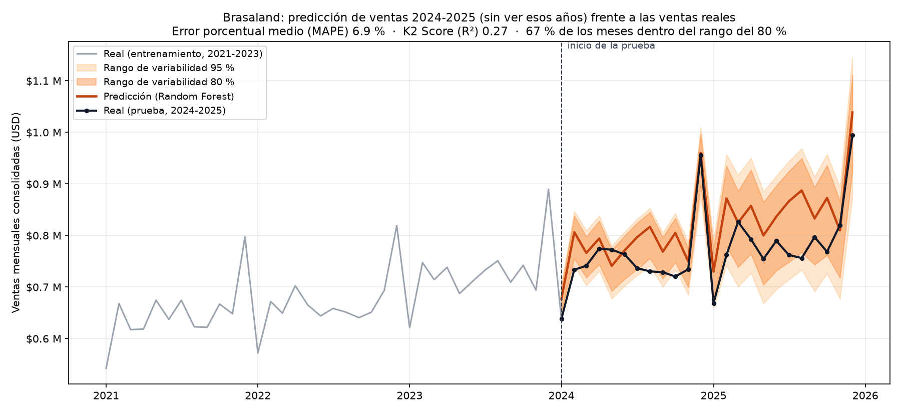

# Predicción de ventas mensuales de Brasaland

Este modelo de regresión responde a la RFI de Finanzas: ¿podemos predecir cuánto venderá la cadena en los próximos meses con un error aceptable, antes de construir un dashboard ejecutivo?

| Pieza | Dónde |
|---|---|
| Dataset provisto (no generado ni simulado) | `data/raw/brasaland_sales.csv`, fila `market = "consolidated"` |
| Preparación, features, modelo y métricas (funciones puras) | `data/process/sales_forecast.py` |
| Script de entrenamiento y evaluación | `scripts/train_sales_forecast.py` |
| Prueba del split 8/2 y de fuga de datos | `tests/pipelines/test_sales_forecast.py` |
| Gráfica y métricas generadas | `data/eval/sales_forecast.png` y `data/eval/sales_forecast_metrics.json` |

```bash
uv run python scripts/train_sales_forecast.py
uv run --group test python -m pytest tests/pipelines/test_sales_forecast.py
```

## Datos y preparación

- **Columnas** (las del BRIEFING): `month`, `revenue_usd`, `covers_served`, `avg_ticket_usd` y `market`. La carga falla si falta alguna.
- **Variable objetivo**: `revenue_usd` de la fila `consolidated`. Las filas de otros mercados se apartan.
- **Nulos y huecos**:
  - Si falta un mes, se crea su fila vacía.
  - Los nulos y las ventas `<= 0` (las ventas deben ser positivas) se rellenan con el valor del mes anterior. Así solo se usa el pasado y no se filtra información del futuro.
  - El script informa de cuántos valores rellenó.
- **Split por fecha**:
  - Entrenamiento: los **primeros 8 años**, 2016-01 a 2023-12 (96 meses).
  - Prueba: los **2 más recientes**, 2024-01 a 2025-12 (24 meses).
  - No comparten ningún mes y todo el entrenamiento es anterior a la prueba.
- **Features causales** (solo usan meses anteriores al que se predice):
  - lags de 1, 2, 3 y 12 meses;
  - media móvil de 3 y 12 meses y desviación típica de 12;
  - crecimiento interanual del último mes y del último trimestre;
  - mes en forma cíclica (seno y coseno);
  - indicadores de enero (caída por vacaciones colectivas) y de diciembre (temporada de fiestas).

  `covers_served` y `avg_ticket_usd` no se usan: su producto es la propia venta del mes, así que usarlas sería fuga.
- **Escalado**: las features en USD (lags y medias) se estandarizan con un `StandardScaler` dentro del pipeline. Así se ajusta **solo con las filas de entrenamiento**. Los árboles no necesitan escalado para decidir sus cortes, pero así ninguna feature domina por su magnitud al comparar importancias.

## Por qué Random Forest y no XGBoost

| Criterio | Este caso | Favorece a |
|---|---|---|
| Tamaño de datos | 120 meses; 83 muestras de entrenamiento tras reservar 13 meses de historia | Random Forest. Con tan pocas filas, el boosting de XGBoost sobreajusta con facilidad |
| Explicabilidad | El público son Finanzas, la CEO y Operaciones | Random Forest. Se explica como "500 árboles dan cada uno una cifra; damos la media y su dispersión" |
| Rango de variabilidad | El ticket lo exige | Random Forest. Cada árbol da su propia predicción, así que la dispersión entre árboles es el rango, sin otro modelo |
| Tiempo de ajuste | Hay pocos datos para validar cruzado | Random Forest. Funciona bien con parámetros casi por defecto |

Parámetros: `n_estimators=500`, `min_samples_leaf=3` (ninguna hoja para un solo mes) y `max_features=0.6`. Además, **`random_state=42`** y `n_jobs=1`, para que el experimento se reproduzca bit a bit.

**Los árboles no extrapolan.** Las ventas crecen entre un 3 % y un 7 % al año, así que 2024-2025 está por encima de cualquier valor del entrenamiento. Por eso el modelo predice la **razón interanual** `revenue_t / revenue_(t-12)`, que es estable (crecimiento por estacionalidad), y la venta se obtiene como esa razón por la venta del mismo mes del año anterior.

**Predicción honesta.** Los 24 meses de prueba se predicen de forma **recursiva** desde 2023-12: cada mes predicho alimenta los lags del siguiente. El modelo no ve ningún valor de 2024-2025, ni siquiera como lag. Un test lo comprueba: si se cambian los años de prueba, la predicción no cambia.

**Rango de variabilidad.** Cada uno de los 500 árboles hace su propia recursión de 24 meses. Las bandas son los percentiles 10-90 (80 %) y 2,5-97,5 (95 %) de esas trayectorias, y se ensanchan en el segundo año porque los errores se acumulan.

## Métricas (sobre los 2 años de prueba)

| Métrica | Qué mide | Cómo leerla |
|---|---|---|
| **MSE** (USD²) | La media del error al cuadrado. Penaliza mucho los meses con errores grandes | Sus unidades (dólares al cuadrado) no se pueden explicar a Finanzas. Por eso se traduce a **RMSE** (USD) y a **MAPE**, el error porcentual medio: "de media nos equivocamos en un X % de la venta del mes" |
| **PSI** (Population Stability Index) | Cuánto cambió la distribución entre entrenamiento y prueba | Menos de 0,10, estable; entre 0,10 y 0,25, cambio moderado; más de 0,25, cambio estructural (nuevos locales, otro mercado) que exige reentrenar. Se calcula sobre la razón interanual (sin tendencia). El PSI de las ventas brutas también se informa, pero siempre sale alto por el crecimiento y no indica un cambio de comportamiento |
| **Gini** (normalizado) | Si el modelo **ordena** bien los meses: si los que predice como flojos son los flojos de verdad | 1 es el orden perfecto y 0, aleatorio. Es lo que necesita Mariana para anticipar los meses de bajo desempeño. No mide el tamaño del error |
| **K2 Score** | Interpretado como el coeficiente de determinación **R²** (`sklearn.metrics.r2_score`): qué parte de la variación mensual real explica la predicción | 1 es perfecto, 0 equivale a predecir siempre la media y un valor negativo es peor que la media |

**Por qué un MSE bajo no basta:**

- El MSE no dice si el error es grande en relación con la venta (para eso está el MAPE).
- No dice si el modelo acierta qué meses serán flojos (para eso está el Gini).
- No dice si el negocio cambió y el modelo quedó obsoleto (para eso está el PSI).
- Medido sobre el entrenamiento, puede salir casi cero solo porque el modelo memorizó el pasado. Por eso todas las métricas se calculan sobre los 2 años de prueba, y el script también informa del MAPE de entrenamiento para enseñar la diferencia.

Además se informa de la **cobertura del rango**: qué porcentaje de meses reales cae dentro de la banda del 80 % y de la del 95 %.

## Resultados (prueba 2024-01 a 2025-12, predicción recursiva desde 2023-12)

El dataset provisto coincide con el BRIEFING:

- 120 meses `consolidated`, sin nulos ni huecos.
- Crecimiento anual alterno: 6,9 / 2,6 / 7,5 / 3,2 / 6,1 / 2,9 / **9,0** / 3,3 / 5,1 %.
- Enero, entre un 7 % y un 16 % por debajo de la media del año anterior.
- Diciembre, entre un 20 % y un 27 % por encima de la media del año.

| Métrica (conjunto de prueba) | Valor | Lectura para Finanzas |
|---|---:|---|
| MSE | 3,98 × 10⁹ USD² | Equivale a un RMSE de **63.104 USD** al mes |
| **MAPE** (error porcentual medio) | **6,9 %** | De media, la predicción se desvía un 6,9 % de la venta real del mes (5,5 % en 2024 y 8,2 % en 2025) |
| Sesgo | +6,4 % | El modelo **sobreestima** casi todos los meses |
| K2 Score (R²) | 0,27 | Explica el 27 % de la variación mes a mes de 2024-2025 |
| Gini normalizado | **0,80** | Ordena bien los meses: identifica los flojos (enero) y los fuertes (diciembre) |
| PSI de la razón interanual (entrenamiento frente a prueba) | **0,18** | **Cambio moderado**: el crecimiento de 2024-2025 no se comporta como el de 2016-2023 |
| PSI de las ventas brutas | 5,65 | Alto solo por la tendencia de crecimiento. No es un cambio de comportamiento |
| Meses dentro del rango del 80 % y del 95 % | 67 % y 88 % | El rango es algo más estrecho de lo que debería |
| MAPE en entrenamiento (dentro de la muestra) | 2,1 % | La diferencia con el 6,9 % de prueba confirma que el error de entrenamiento no sirve como promesa |

**Referencias** (no cambian el modelo y solo sirven para juzgarlo):

| Método | MAPE en prueba |
|---|---:|
| Random Forest, 24 meses recursivos (el modelo) | 6,9 % |
| Línea base ingenua: mismo mes del último año por el crecimiento medio | **4,2 %** |
| Random Forest a un mes vista (cada mes, con los meses reales anteriores) | 4,4 % |



### Interpretación honesta

1. **Por qué sobreestima.** 2023 fue un año anormalmente fuerte: +9,0 % de media, por encima del rango del 3-7 % del BRIEFING. Los features de impulso (crecimiento interanual reciente) lo proyectaron a 2024, que fue un año de crecimiento bajo (+3,3 %), y el error se arrastró al segundo año por la recursión. El **PSI de 0,18** lo detecta.
2. **No se ajustó mirando la prueba.** Se probó un feature de crecimiento de los últimos 12 meses para captar la alternancia de años altos y bajos. Validado **solo dentro de los años de entrenamiento** (ajuste 2016-2021, validación recursiva 2022-2023), no mejoró: MAPE de 3,78 % frente a 3,85 %. Por eso no se incorporó. Elegirlo por su resultado en 2024-2025 habría sido maquillar la prueba.
3. **Para el horizonte de 24 meses, el modelo no supera a una regla estacional simple** (4,2 % frente a 6,9 %). A un mes vista, el uso mensual realista, queda al nivel de esa regla (4,4 %).

### Respuesta a la RFI

- **Viable para anticipar la forma del año**: qué meses serán flojos o fuertes (Gini 0,80) y la magnitud de enero y diciembre. Es lo que necesitan Felipe para las compras de insumos y Lucía para anticipar el volumen.
- **No es todavía fiable para comprometer cifras a 24 meses.** Con un 6,9 % de error y un sesgo al alza, un dashboard ejecutivo debería:
  - usar la predicción a un mes vista, reentrenada cada mes;
  - mostrar siempre el rango, no solo la cifra;
  - vigilar el PSI y reentrenar cuando supere 0,10;
  - mantener la línea base estacional como referencia mínima que el modelo debe superar.
